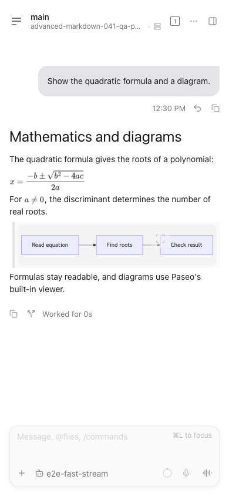
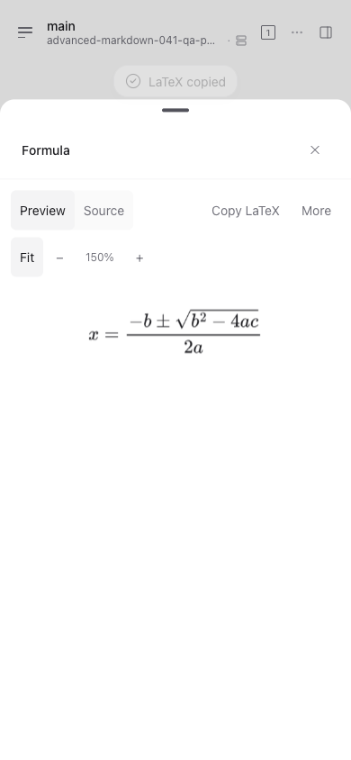

# Advanced Markdown

Render LaTeX formulas in Paseo assistant messages, with a viewer for zooming,
inspecting source, and copying LaTeX or Markdown. Optional viewers add scrolling
for long code lines and wide tables. Mermaid diagrams use Paseo's built-in renderer
and viewer, including in messages that also contain formulas.

These screenshots show version 0.4.1 in a 390px browser on Paseo 0.15.0-beta.1
with the separate host integration fix linked below. They are not native-device
screenshots; the host fix is not included in the plugin.

## Setup and controls

Both Paseo app and daemon must be at least 0.13.0. The daemon host needs Node
22.22 or later and npm. Math is enabled by default; code scrolling and table
viewers are optional in **Settings → Plugins → Advanced Markdown**. Text and
formula size can be adjusted separately. Settings are shared by clients connected
to the same host.

Formulas render on the daemon using bundled assets, without Chrome or another
browser. The plugin does not download software during activation or rendering.
A font on the daemon host must cover non-Latin text used inside formulas. See the
[installation guide](https://github.com/custyhs/paseo-advanced-markdown/blob/main/docs/installation.md)
for font setup and supported environments.

## Data access and limitations

The plugin reads assistant-message Markdown to render matching content. Formula
expressions go to the selected Paseo daemon and rendered images return to the
connected client; no external rendering service is used. Rendered images and
formula assets are cached locally. Clicking a local file link requests a read-only
preview from that host. Files are not read until the link is opened.

Code scrolling uses plain text in place of Paseo's syntax highlighting when
enabled. Formula images support source copying but do not provide selectable
mathematical glyphs or semantic MathML navigation. Mixed prose and inline formulas
still use the plugin's Markdown layout.

Copy, Fork, work duration, and turn collapse in transformed messages depend on the
Paseo host. Unpatched clients can lose those controls; see the separate
[host integration fix](https://github.com/custyhs/paseo-advanced-markdown/blob/main/docs/qa/host-integration.md).
Native iOS/Android devices, Electron, and Windows remain unverified.
