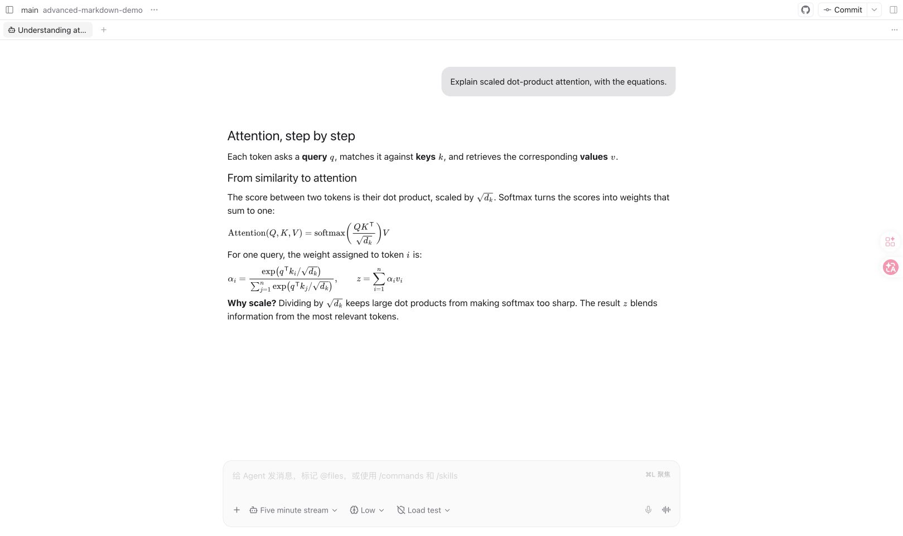
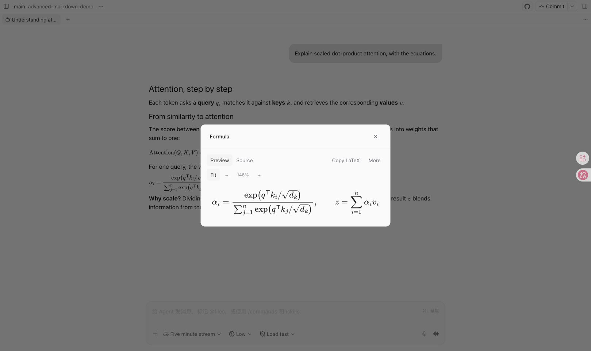
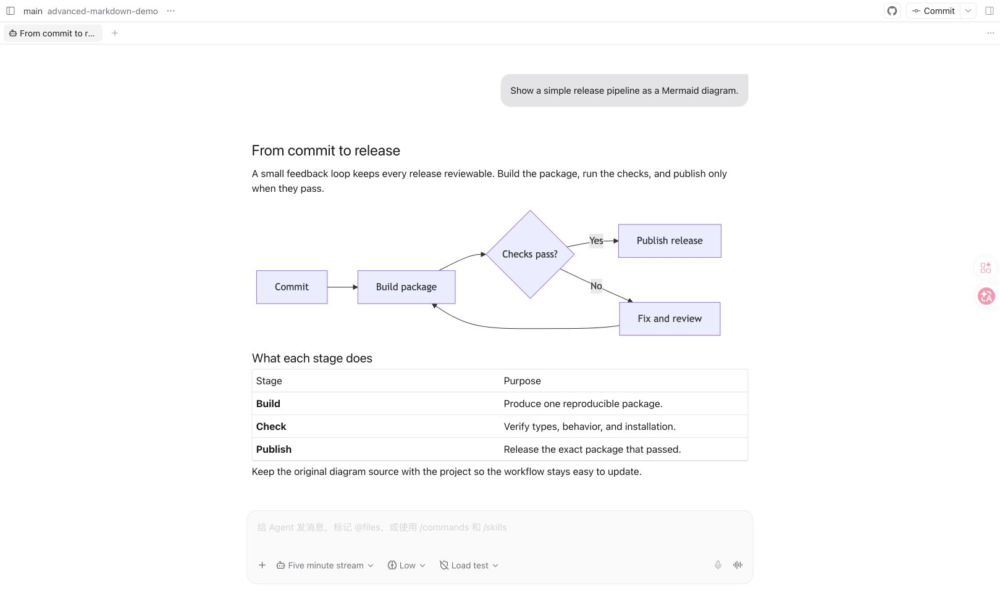

# Advanced Markdown for Paseo

Math formulas and Mermaid diagrams, rendered directly in your
[Paseo](https://paseo.sh) assistant messages.

[Install](#install) · [Plugin catalog](https://paseo.cafe/plugins/advanced-markdown) ·
[npm](https://www.npmjs.com/package/paseo-advanced-markdown) ·
[Release notes](https://github.com/custyhs/paseo-advanced-markdown/releases)

- **Read math and diagrams** alongside text, tables, code, and local file links.
- **Click to inspect** a formula or diagram, zoom in, view its source, and copy it.
- **Keep rendering local** on your Paseo daemon host, with light and dark themes.
- **Optional code and table handling** keeps folder trees from wrapping and wide
  tables from squeezing into unreadable columns on narrow screens.



<details>
<summary>More screenshots: formula viewer and Mermaid diagrams</summary>





Screenshots use sample conversations in the official Paseo 0.9.0-beta.2 web client.

</details>

## Install

**[v0.4.0](https://github.com/custyhs/paseo-advanced-markdown/releases/tag/v0.4.0)
requires Paseo app and daemon `>=0.13.0`, with no upper version limit.**
For Paseo 0.11–0.12, use v0.3.2; for 0.8–0.10, use v0.3.0.
The daemon host needs Node ≥ 22.22, npm, Git, internet access for installation,
and about 700 MiB for the rendering cache.

Enable plugins in **Settings → Plugins**, then run:

```bash
paseo plugin add custyhs/paseo-advanced-markdown --ref v0.4.0
paseo plugin ls
```

Paseo prepares the rendering dependencies automatically. For an existing Git
installation with `--ref` support:

```bash
paseo plugin update advanced-markdown --ref v0.4.0
```

A pinned tag stays on that release until you select a newer tag.

For an existing npm installation, select the npm release instead:

```bash
paseo plugin update advanced-markdown --version 0.4.0
```

See the [installation guide](https://github.com/custyhs/paseo-advanced-markdown/blob/main/docs/installation.md)
for Linux setup, local checkouts, rollback, and troubleshooting.

## Use

Formulas in `$…$`, `\(…\)`, `$$…$$`, `\[…\]`, or `math` fences render automatically.
Click or tap a formula to open its viewer, zoom, and copy LaTeX or Markdown.
On desktop, drag long formulas horizontally. Local file links open a read-only preview.

New installations use Paseo's own Mermaid viewer and syntax-highlighted code blocks.
Turn on **Enhanced Mermaid viewer**, **Enhanced code scrolling**, or **Tables**
to use the plugin's diagram viewer, draggable code blocks, or table viewer with
Markdown/TSV copying. Existing saved settings are preserved when updating.

Change text size, formula size, and enabled modules in
**Settings → Plugins → Advanced Markdown**.

## Compatibility and details

Package checks cover official Paseo 0.13/0.14. Desktop and phone-width browser
checks use a patched 0.15.0-beta.1 client; native iOS/Android and Windows remain
unverified. See the [validation record](docs/qa/host-integration.md).

**Reply actions need a separate Paseo client fix.** In unpatched clients, messages
rendered by a plugin can still lose Copy, Fork, and work duration. Updating this
plugin alone does not repair that host issue; the [host patch](https://github.com/custyhs/paseo/commit/74c11e85a86b453d3a7201698dc122fdfb6fca9b)
retains those actions and turn collapse.

- [Usage and limits](https://github.com/custyhs/paseo-advanced-markdown/blob/main/docs/usage.md) — supported content, viewer behavior, and rendering limits.
- [Development and packaging](https://github.com/custyhs/paseo-advanced-markdown/blob/main/docs/development.md) — local setup, compatibility checks, and release tooling.
- [Report an issue](https://github.com/custyhs/paseo-advanced-markdown/issues) — include your Paseo version, platform, and a sample that reproduces the problem.

Licensed under [Apache-2.0](LICENSE). See [NOTICE](NOTICE) for attribution.
