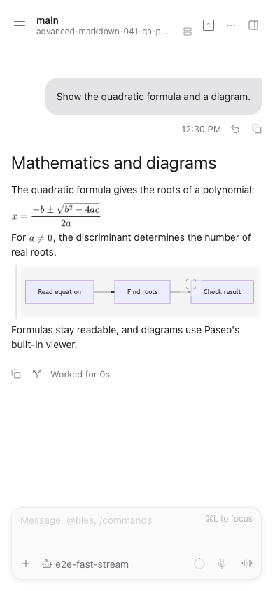
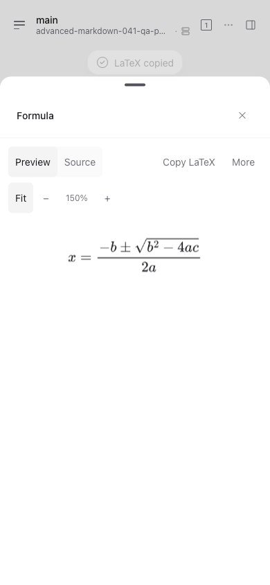

# Advanced Markdown for Paseo

LaTeX formulas in your [Paseo](https://paseo.sh) assistant messages, with a viewer
for zooming, source inspection, and copying. **v0.5.0** adds **Show original**:
one press under a plugin-drawn answer brings back Paseo's own Copy and Fork for
that turn. Mermaid uses Paseo's renderer, and formula rendering needs no browser.
Optional plugin viewers remain for long code lines and wide tables.

[Install](#install-and-update) · [Paseo plugin directory](https://paseo.sh/plugins) ·
[npm](https://www.npmjs.com/package/paseo-advanced-markdown) ·
[Release notes](https://github.com/custyhs/paseo-advanced-markdown/releases)

## Features

| Content | Default in a new installation | Plugin controls |
| --- | --- | --- |
| Math | Plugin rendering enabled | Inline and display formulas, independent size, horizontal scrolling, zoom, LaTeX/Markdown copy |
| Mermaid | Paseo's renderer and viewer | No separate plugin renderer or browser installation |
| Code | Paseo's syntax highlighting and copy | Enable **Enhanced code scrolling** for draggable long lines and text-selection mode; this mode uses plain text |
| Tables | Enhanced viewer off | Enable **Tables** for a wide-table viewer and Markdown/TSV copy |

Formulas support `$…$`, `\(…\)`, `$$…$$`, `\[…\]`, and `math` fences. Click or tap
a formula to open **Preview** or **Source**. On desktop, drag overflowing formulas
horizontally. Local file links inside plugin-rendered messages open a read-only preview.

**Copy LaTeX** copies the expression. **Copy fragment Markdown** copies the original
Markdown of the assistant message containing it, which may be only one part of a turn.

Configure modules and text/formula size in **Settings → Plugins → Advanced Markdown**.
Settings are shared by clients of the host. Updating preserves math, code, table,
and sizing preferences. The removed **Enhanced Mermaid viewer** setting is ignored,
including an older saved `mermaid: true` value.

<details>
<summary>Screenshots</summary>





These v0.4.1 screenshots were captured at 390px in a browser on Paseo
0.15.0-beta.1 with the separate host integration fix described below.
They are not native-device screenshots; the host fix is not included in the plugin.

</details>

## Install and update

**Both Paseo app and daemon must be `>=0.13.0`; there is no upper version limit.**
For Paseo 0.11–0.12, use v0.3.2; for 0.8–0.10, use v0.3.0.
The daemon host needs Node ≥ 22.22 and npm. Package installation needs network
access; formula rendering and asset repair work offline. Git installations also
require Git. No Chrome, Chromium, or Mermaid CLI installation is required.

Enable plugins in **Settings → Plugins**, then install from npm:

```bash
paseo plugin add npm:paseo-advanced-markdown@0.5.0
paseo plugin ls
```

Update an existing npm installation:

```bash
paseo plugin update advanced-markdown --version 0.5.0
```

For a Git installation, use `paseo plugin update advanced-markdown --ref v0.5.0`.
A pinned version or tag stays on that release until you select another one.
Paseo prepares the bundled formula assets without downloading software. See the
[installation guide](https://github.com/custyhs/paseo-advanced-markdown/blob/main/docs/installation.md)
for Git/local setup, Linux requirements, rollback, and troubleshooting.

## How it works

1. **Select messages.** The [client transformer](https://github.com/custyhs/paseo-advanced-markdown/blob/main/index.client.tsx)
   scans accumulated assistant text, including streaming updates. It requests
   custom rendering only when an enabled module matches. Ordinary messages,
   including Mermaid-only messages, stay with Paseo.
   Messages outside supported syntax or size limits also stay with Paseo.
   When **Show original for Fork** is on, the transformer also draws plain
   replies that precede a plugin-drawn answer in the same turn
   (see [Reply actions and compatibility](#reply-actions-and-compatibility)).
2. **Render mixed content.** A selected message passes its original Markdown to
   the [plugin message renderer](https://github.com/custyhs/paseo-advanced-markdown/blob/main/client/message.tsx).
   Math nodes use the formula components. Valid Mermaid blocks always use Paseo's
   public `Markdown` component. Ordinary code uses it unless enhanced code scrolling
   is enabled.
   Parsed block content and language are preserved inside lists and quotes.
3. **Generate formula images on the host.** RPCs send expressions to MathJax,
   which produces SVG; resvg converts it to PNG using WASM. Formula rendering uses
   no browser or external rendering service. Mermaid rendering runs in Paseo's client.
4. **Display and recover.** The client uses image metrics for inline layout,
   scrolling, and zoom. Original source remains available for copying and error
   fallback. Render caches avoid repeated work, and bundled recovery data repairs
   missing or damaged formula assets offline at startup.

This is a partial reuse of Paseo's renderer. Prose mixed with inline math still
uses the plugin's Markdown engine, as do basic tables inside those messages.
Paseo's native selection and layout improvements therefore do not automatically
apply to the whole custom-rendered message. The transformer changes presentation,
not the stored conversation source.

## Reply actions and compatibility

Paseo builds a turn's Copy, Fork, and work duration from native assistant rows.
On released clients, a turn whose every reply is a plugin row gets no footer,
and a plain reply before a plugin-drawn answer anchors a Fork that cuts the
answer off. **v0.5.0 adds Show original**, which reaches Copy and Fork on any
official host from 0.13.0, without a patched client:

- Under the final reply of a completed turn it draws, the plugin shows a footer
  with **Copy turn**, **Show original**, and the turn's end time. Show original
  hands the whole turn back to Paseo — formulas show as TeX source — so Paseo's
  own Copy, Fork, and duration appear. A composer pill ("Original view ·
  N turns") restores plugin rendering, and so does a reload.
- In turns where a plain reply precedes the formula answer, the plugin also
  draws that plain reply, so Paseo never shows a Fork anchored before the final
  answer. When it cannot — a short or repeated plain reply without a message
  id — the footer adds a warning that Paseo's Fork below stops before this
  answer. Replies without a message id are keyed by their exact text and can be
  left unprotected this way; in the 0.16.0 QA, a daemon restart kept Claude
  message ids.
- The host-scoped switch **Show original for Fork** in the plugin's Modules
  settings is on by default; off restores the 0.4.1 behavior exactly.

**Better Paseo:** its **Plugin markdown for replies** must be off for Paseo's
Fork to appear; the first Show original of a session shows a toast saying so.
With it on, replies this plugin declines go to Better Paseo, and Fork stays
unavailable.

**Paseo versions:**

- On 0.16.0, a turn whose plain replies the plugin draws folds under Collapse
  turns with its answer visible, and Show original keeps it folded. On 0.15.x
  such a turn does not fold until Show original.
- On 0.13.x, turns started by heartbeats or agent messages can still show an
  early-anchored Fork before Show original.
- A host that keeps its own footer for plugin-rendered replies —
  [getpaseo/paseo#9253](https://github.com/getpaseo/paseo/pull/9253), open, in
  no release — shows Paseo's footer under typeset replies with no setting
  change; the plugin draws no footer there. That upstream opt-in is the
  long-term path. The separately maintained
  [host patch](https://github.com/custyhs/paseo/commit/74c11e85a86b453d3a7201698dc122fdfb6fca9b)
  remains an alternative.

Known limitations: an early-anchored footer can appear when a chat opens, until
the plugin's first timeline read returns; unprotected turns keep Paseo's early
Fork, with the warning shown; identical plugin-drawn replies switch to the
original view together; a duplicate reply in a chat the plugin has not read yet
stays plugin-drawn for one read round trip; read-only subagent panes offer no
Fork, so Show original restores only Copy and time there; and if #9253 lands
under another field name, hosts with it behave like released hosts until a
plugin release follows.

See the [design](https://github.com/custyhs/paseo-advanced-markdown/blob/main/docs/superpowers/specs/2026-11-07-fork-safe-replies-design.md),
the [Paseo 0.16.0 QA record](https://github.com/custyhs/paseo-advanced-markdown/blob/main/docs/qa/fork-safe-replies.md),
and the [0.5.0 release notes](https://github.com/custyhs/paseo-advanced-markdown/blob/main/docs/release/0.5.0.md).
The [0.4.0 integration record](https://github.com/custyhs/paseo-advanced-markdown/blob/main/docs/qa/host-integration.md)
with the patched host remains historical evidence. Native iOS/Android devices,
Electron, and Windows remain unverified.

## Further reading

- [Usage and limits](https://github.com/custyhs/paseo-advanced-markdown/blob/main/docs/usage.md) — viewer behavior, source copying, and supported content.
- [Development and packaging](https://github.com/custyhs/paseo-advanced-markdown/blob/main/docs/development.md) — build, targeted tests, package preparation, and asset recovery.
- [Report an issue](https://github.com/custyhs/paseo-advanced-markdown/issues) — include your Paseo version, platform, and a reproducing Markdown sample.

Licensed under [Apache-2.0](LICENSE). See [NOTICE](NOTICE) for attribution.
