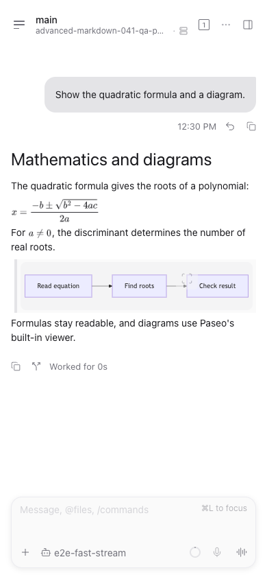
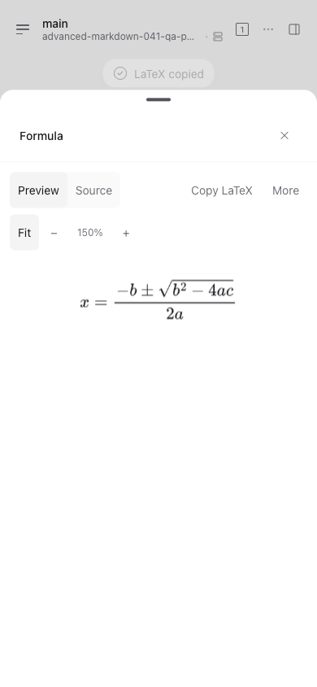

# Advanced Markdown for Paseo

LaTeX formulas in your [Paseo](https://paseo.sh) assistant messages, with a viewer
for zooming, source inspection, and copying. **v0.4.1** uses Paseo's own Mermaid rendering and removes the plugin's
Chrome-based diagram renderer. Formula rendering needs no browser. Optional
plugin viewers remain for long code lines and wide tables.

[Install](#install-and-update) · [Paseo plugin directory](https://paseo.sh/plugins) ·
[npm](https://www.npmjs.com/package/paseo-advanced-markdown) ·
[Release notes](https://github.com/custyhs/paseo-advanced-markdown/releases)

## Features

| Content | Default in a new installation | Plugin controls |
| --- | --- | --- |
| Math | Plugin rendering enabled | Inline and display formulas, independent size, horizontal scrolling, zoom, LaTeX/Markdown copy |
| Mermaid | Paseo's renderer and viewer | No separate plugin renderer or browser installation |
| Code | Paseo's syntax highlighting and copy | Enable **Enhanced code scrolling** for draggable long lines and text-selection mode; this mode uses plain text |
| Tables | Enhanced viewer off | Enable **Tables** for a wide-table viewer and Markdown/TSV copy |

Formulas support `$…$`, `\(…\)`, `$$…$$`, `\[…\]`, and `math` fences. Click or tap
a formula to open **Preview** or **Source**. On desktop, drag overflowing formulas
horizontally. Local file links inside plugin-rendered messages open a read-only preview.

**Copy LaTeX** copies the expression. **Copy fragment Markdown** copies the original
Markdown of the assistant message containing it, which may be only one part of a turn.

Configure modules and text/formula size in **Settings → Plugins → Advanced Markdown**.
Settings are shared by clients of the host. Updating preserves math, code, table,
and sizing preferences. The removed **Enhanced Mermaid viewer** setting is ignored,
including an older saved `mermaid: true` value.

<details>
<summary>Screenshots</summary>





These v0.4.1 screenshots were captured at 390px in a browser on Paseo
0.15.0-beta.1 with the separate host integration fix described below.
They are not native-device screenshots; the host fix is not included in the plugin.

</details>

## Install and update

**Both Paseo app and daemon must be `>=0.13.0`; there is no upper version limit.**
For Paseo 0.11–0.12, use v0.3.2; for 0.8–0.10, use v0.3.0.
The daemon host needs Node ≥ 22.22 and npm. Package installation needs network
access; formula rendering and asset repair work offline. Git installations also
require Git. No Chrome, Chromium, or Mermaid CLI installation is required.

Enable plugins in **Settings → Plugins**, then install from npm:

```bash
paseo plugin add npm:paseo-advanced-markdown@0.4.1
paseo plugin ls
```

Update an existing npm installation:

```bash
paseo plugin update advanced-markdown --version 0.4.1
```

For a Git installation, use `paseo plugin update advanced-markdown --ref v0.4.1`.
A pinned version or tag stays on that release until you select another one.
Paseo prepares the bundled formula assets without downloading software. See the
[installation guide](https://github.com/custyhs/paseo-advanced-markdown/blob/main/docs/installation.md)
for Git/local setup, Linux requirements, rollback, and troubleshooting.

## How it works

1. **Select messages.** The [client transformer](https://github.com/custyhs/paseo-advanced-markdown/blob/main/index.client.tsx)
   scans accumulated assistant text, including streaming updates. It requests
   custom rendering only when an enabled module matches. Ordinary messages,
   including Mermaid-only messages, stay with Paseo.
   Messages outside supported syntax or size limits also stay with Paseo.
2. **Render mixed content.** A selected message passes its original Markdown to
   the [plugin message renderer](https://github.com/custyhs/paseo-advanced-markdown/blob/main/client/message.tsx).
   Math nodes use the formula components. Valid Mermaid blocks always use Paseo's
   public `Markdown` component. Ordinary code uses it unless enhanced code scrolling
   is enabled.
   Parsed block content and language are preserved inside lists and quotes.
3. **Generate formula images on the host.** RPCs send expressions to MathJax,
   which produces SVG; resvg converts it to PNG using WASM. Formula rendering uses
   no browser or external rendering service. Mermaid rendering runs in Paseo's client.
4. **Display and recover.** The client uses image metrics for inline layout,
   scrolling, and zoom. Original source remains available for copying and error
   fallback. Render caches avoid repeated work, and bundled recovery data repairs
   missing or damaged formula assets offline at startup.

This is a partial reuse of Paseo's renderer. Prose mixed with inline math still
uses the plugin's Markdown engine, as do basic tables inside those messages.
Paseo's native selection and layout improvements therefore do not automatically
apply to the whole custom-rendered message. The transformer changes presentation,
not the stored conversation source.

## Reply actions and compatibility

**Copy, Fork, work duration, and turn collapse need a separate Paseo client fix.**
Unpatched clients replace transformed assistant messages with plugin rows and
can lose those host controls. Installing this plugin alone does not fix this.
The [host patch](https://github.com/custyhs/paseo/commit/74c11e85a86b453d3a7201698dc122fdfb6fca9b)
keeps the original assistant message and inserts plugin output into its body;
it is maintained separately from this npm package.

The [0.4.0 integration record](https://github.com/custyhs/paseo-advanced-markdown/blob/main/docs/qa/host-integration.md)
covers official Paseo 0.13.0, 0.14.0, and 0.15.0-beta.1 package checks and browser
interaction with the patched host. It is historical evidence, not a 0.4.1 test
result. See the [0.4.1 release notes](https://github.com/custyhs/paseo-advanced-markdown/blob/main/docs/release/0.4.1.md)
for this change. Native iOS/Android devices, Electron, and Windows remain unverified.

## Further reading

- [Usage and limits](https://github.com/custyhs/paseo-advanced-markdown/blob/main/docs/usage.md) — viewer behavior, source copying, and supported content.
- [Development and packaging](https://github.com/custyhs/paseo-advanced-markdown/blob/main/docs/development.md) — build, targeted tests, package preparation, and asset recovery.
- [Report an issue](https://github.com/custyhs/paseo-advanced-markdown/issues) — include your Paseo version, platform, and a reproducing Markdown sample.

Licensed under [Apache-2.0](LICENSE). See [NOTICE](NOTICE) for attribution.
