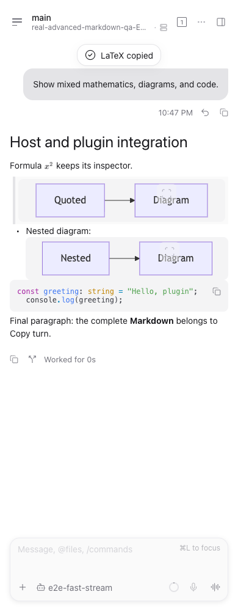

# Assistant message integration

Plugin release: v0.4.0, requiring Paseo >=0.13.0 without an upper limit.
Host patch: [`74c11e85a`](https://github.com/custyhs/paseo/commit/74c11e85a86b453d3a7201698dc122fdfb6fca9b),
based on official Paseo v0.15.0-beta.1 (`8bd38fb23645652078cb629baa2e65e0b6baa65a`).

## Diagnosis

The old host projection changed an assistant message into a plugin row. Reply
layout, turn-copy, fork boundaries and turn collapse identify assistant messages
by their kind. As a result, transformed final messages lost their footer; mixed
turns could copy only the untransformed text or fork at an earlier message.
This is a host presentation problem, not a formula image covering the buttons.

The host fix keeps the original assistant row, text, source identity and timeline
cursor. Plugin output becomes a presentation-only body override. Multiple output
items share one assistant row and its normal turn actions. Existing renderer
validation, plugin context and per-item error boundaries still apply. An explicit
empty transform continues to hide its source; canonical plugin rows and other
source types retain their existing contract. No protocol or public SDK change is
required, so existing transformer plugins benefit from the host fix.

The host patch is maintained separately from this plugin and is not included in
the npm package. Installing v0.4.0 alone cannot repair reply actions in an unpatched
client; the client must include the host patch.

## Plugin boundaries

- Math parsing, image metrics, scrolling, source copying and the formula viewer
  remain plugin features. Ordinary prose and mixed inline math still use the
  plugin's Markdown engine; cross-paragraph native selection does not become the
  official renderer's behavior through this change.
- Valid Mermaid blocks and ordinary code use the public `Markdown` component
  by default, including within math messages. Enhanced Mermaid and code controls
  remain opt-in. Existing saved switches are preserved.
- Blocks are rebuilt from parsed content and the AST's `sourceInfo`, using a safe
  fence length. Raw nested list/quote source is not reparsed outside its container.
  Unclosed, empty or over-budget math/Mermaid fences retain their source fallback.
- Tables keep the existing optional viewer and Markdown/TSV copy behavior. The
  basic table renderer inside a plugin message is still the plugin's renderer.
- Local file links keep the read-only preview. The reviewed public timeline props
  expose no file navigation API; navigation on other surfaces does not make one
  available to timeline renderers.
- The public `Markdown` component and consolidated `/client/ui` exports require
  Paseo 0.13. The old `/client/react-native` imports are removed. Paseo 0.11–0.12
  users can keep v0.3.2.

Splitting all prose around formulas into separate Markdown components would lose
list/reference context and fragment native selection. A complete engine migration
needs a public math-node extension point and is outside this change.

## Verification

- Host projection, presentation and virtualized height tests: 55 tests passed
  across three test files. These cover web/Android ordering, math and Mermaid,
  mixed native/plugin replies, tools before/after replies, full-source copy,
  fork cursors, multiple outputs and turn collapse. App typecheck passed.
- Plugin block serialization/routing, parser and settings tests: 76 tests passed
  across three files, including saved preferences and invalid fence fallbacks.
  Another 32 version-gate tests passed for app and daemon compatibility.
- Host browser E2E: eight tests passed at 1100 and 390 pixels. Copy used the full
  original Markdown once; forking an earlier reply excluded subsequent turns;
  collapsing and expanding work retained the final reply. Existing streaming,
  reload, reconnect and consecutive-tool regressions also passed.
- Find: ten real-browser tests passed. Custom bodies retain block boundaries and
  hidden-text filtering; host footer labels do not become search results.
- Real Advanced Markdown integration: both 1100 and 390 pixels passed with the
  patched host, actual plugin installation and actual MathJax/Mermaid RPCs. Checked
  formula images and LaTeX copy, nested quote/list Mermaid through the official
  renderer, syntax-highlighted code and exact source copy, plugin-enhanced diagram
  and code controls, complete turn copy, and the presence of Fork.
- Package smoke passed with official 0.13.0 and 0.14.0 compilers: fresh production
  installation, relocation, real formula/diagram PNGs, empty/corrupt asset cache
  recovery, and recovery after removing original package assets. The package
  source budget is 66 files / 1,183,957 bytes, below the catalog limits.
- Build, typecheck and lint passed. The client bundle also passed real Hermes
  evaluation with both class-transform modes; this checks JavaScript loading,
  registration and transformation, not native UI.

Browser checks used isolated Google Chrome 156 profiles on macOS and independent
daemon homes. The first new E2E attempt needed a corrected Fork button label;
the compact real-plugin test needed the visible Close control for its sheet.
Both were test-locator issues, followed by passing runs. Production state was not
modified. iOS/Android devices, Electron and Windows remain unverified.

The maintainer workspace retains full logs and screenshots under the plugin's
`.smoke/host-integration-ui/` and the host worktree's `.dev/host-integration-qa/`.
Package reports are `.smoke/npm/smoke-0.13.0.json` and `smoke-0.14.0.json`.

The legacy 0.8 fixture in `npm run smoke` is retained only as a historical parser
regression. It is not evidence that reply actions work in a current host.

## Source references

- [Original host projection](https://github.com/getpaseo/paseo/blob/8bd38fb23645652078cb629baa2e65e0b6baa65a/packages/app/src/plugins/timeline/projection.ts)
- [Reply layout](https://github.com/getpaseo/paseo/blob/8bd38fb23645652078cb629baa2e65e0b6baa65a/packages/app/src/agent-stream/layout.ts)
- [Turn collapse](https://github.com/getpaseo/paseo/blob/8bd38fb23645652078cb629baa2e65e0b6baa65a/packages/app/src/agent-stream/turn-collapse/model.ts)
- [Public plugin props](https://github.com/getpaseo/paseo/blob/8bd38fb23645652078cb629baa2e65e0b6baa65a/packages/plugin/src/client/contracts.ts)
- [Official Markdown boundaries](https://github.com/getpaseo/paseo/blob/8bd38fb23645652078cb629baa2e65e0b6baa65a/docs/markdown-renderer.md)
